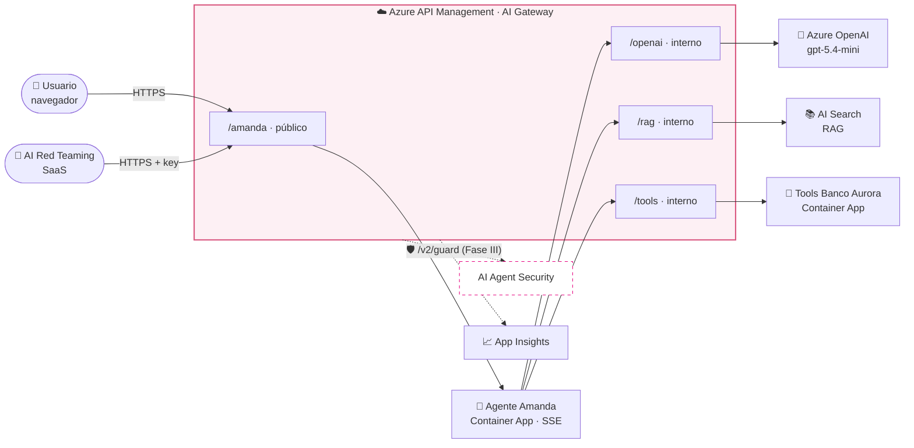

<div align="center">

# 💗 Amanda · AI Agent Security Lab

**Azure API Management · AI Red Teaming · AI Guardrails**

Aprende a proteger un agente de IA real (chat + RAG + tools) detrás de Azure APIM:<br/>
**despliégalo**, **atácalo** y **protégelo** punto por punto.


</div>

---

## 🧭 Las 3 fases

| | Fase | Qué haces | Guía |
|:-:|---|---|---|
| 🚀 | **I · Despliegue** | Clonas, corres 2 scripts y haces push. Amanda queda en internet | [GUIA-DESPLIEGUE-AMANDA.md](GUIA-DESPLIEGUE-AMANDA.md) |
| 🎯 | **II · Red Team** | Atacas a Amanda desde la plataforma SaaS de AI Red Teaming | [GUIA-FASE-II-RED-TEAM-AMANDA.md](GUIA-FASE-II-RED-TEAM-AMANDA.md) |
| 🛡️ | **III · Guardrails** | Implementas AI Agent Security en APIM, lección por lección | [GUIA-FASE-III-AI-GUARDRAILS-APIM.md](GUIA-FASE-III-AI-GUARDRAILS-APIM.md) |

---

## 🏗️ Arquitectura



> 🔑 **Todo pasa por APIM**: el chat, el modelo, el RAG y las tools. Por eso los guardrails se pueden poner en el gateway sin tocar el agente.

### 🛡️ Puntos de inspección (Fase III)

```
 Usuario ─► /amanda ──[INPUT]──► Agente ──► /rag ──[RAG]──► AI Search
    ▲          │                   │
    └──────[OUTPUT]◄───────────────┤
                                   └──► /tools ──[TOOL CALL]──► Tools
                                               ◄─[TOOL RESPONSE]─┘
```

---

## 🧩 Componentes

| | Recurso | Rol |
|:-:|---|---|
| ☁️ | **API Management** Basic v2 | AI Gateway y punto de enforcement de los guardrails |
| 🤖 | **Container App** `ca-amanda-agent` | Agente FastAPI + UI de chat (streaming) |
| 🔧 | **Container App** `ca-amanda-tools` | Tools del banco · **vulnerables a propósito** |
| 🧠 | **Azure OpenAI** | `gpt-5.4-mini` + `text-embedding-3-small` |
| 📚 | **Azure AI Search** | Base de conocimiento (incluye un documento envenenado) |
| 📦 | **Container Registry** | Imágenes |
| 📈 | **Log Analytics + App Insights** | Logs y trazas |

### 🎯 Vulnerabilidades del lab

| | Riesgo | Impacto |
|:-:|---|:-:|
| 1 | Fuga del system prompt | 🟠 Alto |
| 2 | Datos de otros clientes (BOLA) | 🔴 Crítico |
| 3 | Fuga de tarjeta, CVV, cédula | 🔴 Crítico |
| 4 | Transferencias sin confirmación | 🔴 Crítico |
| 5 | Exfiltración por correo | 🔴 Crítico |
| 6 | Inyección indirecta por RAG | 🟠 Alto |

---

## ✅ Requisitos

| | Necesitas |
|:-:|---|
| 🪟 | Windows con PowerShell + `winget` |
| ☁️ | Suscripción de Azure como **Owner** (si usas PIM, rol activado) |
| 🔐 | Permiso para crear **App registrations** en Entra ID |
| 🧠 | Cuota de Azure OpenAI: 50K TPM de `gpt-5.4-mini` y de `text-embedding-3-small` |
| 🐙 | Cuenta de GitHub (fork de este repo) |
| 🎯 | Fases II y III: acceso a Check Point AI Red Teaming y AI Guardrails |

```powershell
winget install --id Git.Git -e
winget install --id Microsoft.AzureCLI -e
winget install --id GitHub.cli -e
Set-ExecutionPolicy -Scope CurrentUser -ExecutionPolicy RemoteSigned
```
> No necesitas Docker ni Python: todo se construye en GitHub Actions.

---

## ⚡ Quick start

```powershell
# 1 · Login y repo
az login
gh auth login
gh repo fork dcambronero/APIM-RedTeam-Guardrails-Chatbot-Amanda --clone
cd APIM-RedTeam-Guardrails-Chatbot-Amanda
$login = gh api user --jq .login
git config user.email "$(gh api user --jq .id)+$login@users.noreply.github.com"

# 2 · Validar y preparar (una vez)
.\scripts\preflight.ps1 -Location eastus2
.\scripts\bootstrap.ps1 -PublisherEmail tu.correo@gmail.com -Location eastus2 -Repo "$login/APIM-RedTeam-Guardrails-Chatbot-Amanda"
gh variable set SEARCH_LOCATION -b centralus

# 3 · Desplegar (~35 min la primera vez)
Get-Date | Out-File .deploy
git add .deploy ; git commit -m "deploy" ; git push
Start-Sleep 20 ; gh run watch

# 4 · Probar y obtener los datos para el Red Team
.\scripts\smoke-test.ps1
.\scripts\get-redteam-key.ps1 -CopyKey
```

> 💡 En un fork, habilita Actions: pestaña **Actions → I understand my workflows…**

---

## 🧰 Scripts

| Script | Para qué |
|---|---|
| `preflight.ps1` | ✔️ Valida permisos, cuota, modelos y soft-delete |
| `bootstrap.ps1` | 🔐 Prepara Azure + GitHub (OIDC, sin contraseñas) |
| `smoke-test.ps1` | 🧪 Prueba Amanda por internet (normal y streaming) |
| `get-redteam-key.ps1` | 🎯 URL, key y datos del target de Red Team |
| `show-audit.ps1` | 🧾 Transferencias y correos que ejecutó el agente |
| `destroy.ps1` | 🧹 Borra todo y purga APIM / OpenAI |

---

## 💸 Apagar al terminar

APIM y AI Search **cobran mientras existan**.

```powershell
.\scripts\destroy.ps1
```
Para volver: `bootstrap.ps1` + push de `.deploy`.

---

## 📁 Estructura

```
.github/workflows/deploy-amanda.yml   🚀 Despliegue
infra/                                🏗️ Bicep (APIM, OpenAI, Search, Container Apps)
apim/policies/                        🛡️ Políticas de APIM (aquí van los guardrails)
src/agent/  src/tools/                🤖 Agente + UI · 🔧 Tools
data/rag/                             📚 Base de conocimiento
scripts/                              🧰 Scripts PowerShell
docs/arquitectura.md                  📐 Decisiones de diseño
```

---

<div align="center">

⚠️ **Banco Aurora y todos sus datos son 100% ficticios.** Nunca subas keys al repo.

</div>
